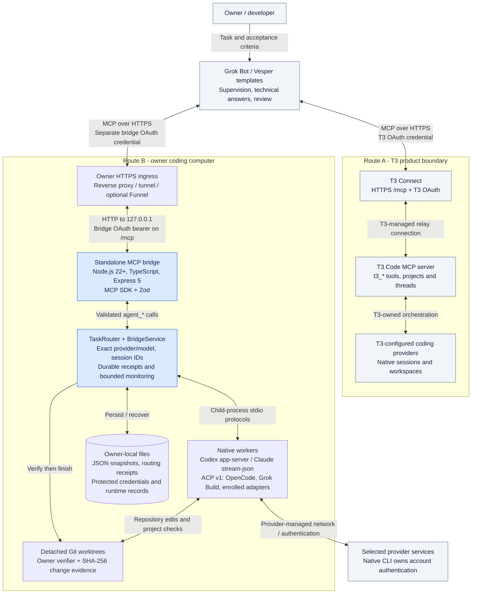

# Vesper Grok Bot Bridge

[](https://github.com/Vedant817/vesper-grok-bot-bridge/actions/workflows/ci.yml)
[](https://www.npmjs.com/package/grok-bot-mcp-agent)

Use Grok Bot to supervise coding agents: start a task, inspect the agent's response, resolve delegated technical input, request improvements in the same session, and review real verification before accepting work.

Explore the [system design diagrams, technology stack and architecture walkthrough](docs/SYSTEM_DESIGN.md).

## Choose your setup

We maintain **two focused Bot templates**, with different tool contracts. [Full route comparison](docs/ROUTES.md).

| What you use | Bot template | MCP server | Setup guide |
| --- | --- | --- | --- |
| T3 Code | [Vesper — T3](https://x.ai/bot/H2br1687IFJlyapDHroic) ([source](community/t3/PROFILE.md)) | T3 already supplies its server through T3 Connect; no bridge install | [T3 setup](docs/T3_CONNECT_QUICKSTART.md) |
| Coding CLIs without T3 | [Vesper — CLI](https://x.ai/bot/BuUvKwDGbSoqwNvNDreQk) ([source](community/cli/PROFILE.md)) | Install this project's CLI/MCP bridge once; enroll multiple ACP/native CLIs | [Standalone MCP setup](docs/STANDALONE.md), [provider enrollment](docs/CLI_CONNECTIONS.md) |

Recipients add a published Bot through the Grok Bot Marketplace or a shared template link. The profiles above are the publisher source files. **Both templates are published and shareable:** [Vesper — CLI](https://x.ai/bot/BuUvKwDGbSoqwNvNDreQk) and [Vesper — T3](https://x.ai/bot/H2br1687IFJlyapDHroic); inside the Grok Bot app the one-click add links are `grokbot://app/v1/bot-template?id=BuUvKwDGbSoqwNvNDreQk` and `grokbot://app/v1/bot-template?id=H2br1687IFJlyapDHroic`. Custom MCP servers are installed separately; importing a Bot does not install software or authenticate coding accounts. [Template publishing details](community/README.md).

A combined Bot is optional for advanced users who connect both resources and select the route explicitly. It is not the default offering and must never silently move work between backends. There is one MCP server implementation in this repository, not one server per CLI. T3's server is a separate product.

## System architecture

The two routes are selected explicitly and use separate MCP servers and credentials.



All five diagrams are saved in [docs/diagrams](docs/diagrams/README.md), with editable Mermaid sources and SVG exports. See the [full system-design guide](docs/SYSTEM_DESIGN.md) for networking, OAuth, task verification, optional integrations and the technology inventory.

## Standalone MCP: install once

Requires Node.js 22+, npm, Git and your chosen authenticated coding CLI/ACP adapter. Install the published package from [npm](https://www.npmjs.com/package/grok-bot-mcp-agent):

```powershell
npm install -g grok-bot-mcp-agent
grok-agent-bridge setup --repository C:/Code/my-project
grok-agent-bridge doctor
```

Prefer a checksum-verified offline archive? Download the runtime archive from a trusted [GitHub release](https://github.com/Vedant817/vesper-grok-bot-bridge/releases), verify its SHA-256 sidecar, then install it by local path (`npm install -g ./grok-bot-mcp-agent-<version>.tgz`).

For repositories without a suitable detected test/check command, enroll the real verifier explicitly. Then enroll your exact ACP executable/model, configure a stable owner-controlled HTTPS gateway and approve OAuth locally. **Continue with [the complete standalone guide](docs/STANDALONE.md)**; the three commands above alone do not connect Grok Bot's cloud connector to your computer.

Setup persists per-user paths and credentials and configures supported sign-in startup. Workers run in background isolated Git worktrees; no visible terminal or T3 installation is required. A single installed bridge can operate multiple owner-enrolled CLIs. Local MCP hosts can use `grok-agent-bridge connect` over stdio. Grok Bot uses the authenticated HTTPS/OAuth route. No xAI API key is needed when Grok Bot supplies reasoning.

## T3 MCP: connect once

Install and configure T3 Code and its coding provider, enable T3 Connect, then add your environment's HTTPS `/mcp` URL as a remote Grok Bot connector and approve native OAuth. Do not install this bridge merely to use T3. Follow [T3 setup and acceptance](docs/T3_CONNECT_QUICKSTART.md) and [the T3 Bot role](docs/T3_BOT_INSTRUCTIONS.md).

## Permissions, accounts and availability

Use your own accounts and approved authentication. Keep native approvals, administrator controls and budgets in force. Credentials, MFA, CAPTCHA, payment and human-only approvals remain human handoffs. Stop on quota/policy failures; no account rotation, token extraction, silent model substitution or uncertain task replay. The bridge is not an OS sandbox or a multi-tenant credential proxy.

Read [the current provider-policy review](docs/PROVIDER_POLICY.md) before use or publication. It covers OpenAI, Anthropic, xAI and other workers, including subscription-versus-API and hosted/commercial boundaries. ACP support and passing tests are not vendor approval, and nobody can guarantee immunity from account restrictions.

CLIProxyAPI-style multi-account pooling, automatic failover on quota/authentication errors, and client fingerprint cloaking are not integrated; the [assessment](docs/research/CLIPROXYAPI.md) explains the account and contract risk.

A VPN or Tailscale tunnel protects the network path, not the provider account. See [remote access and network safety](docs/NETWORK_SECURITY.md) for T3 Connect, Tailscale Serve/Funnel and tunnel boundaries.

The coding computer must stay awake and online with its selected backend and tunnel running. Persisted enrollment is not a promise of indefinite OAuth validity. Native Grok Bot approval cards can still interrupt unattended work; physical reboot and app-closed operation remain separate acceptance limits. [Live results and limitations](docs/CLI_CONNECTIONS.md), [verification history](docs/VERIFICATION.md).

## Develop and distribute

```sh
npm ci
npm run lint
npm test -- --no-file-parallelism --maxWorkers 1
npm run build
npm run pack:community
```

The final command builds the installable CLI/MCP runtime and a **publisher source kit containing both Bot definitions**, with SHA-256 sidecars and a release manifest under `build/releases/`. Ordinary marketplace users do not need the source kit. Nothing is published, enrolled or installed globally by that build. [Distribution guide](docs/DISTRIBUTION.md).

See [CONTRIBUTING.md](CONTRIBUTING.md) for the directory map and contribution workflow, and [the documentation index](docs/README.md) for all guides. The optional [legacy API-key supervisor](docs/LEGACY_SUPERVISOR.md) is documented separately.

Unofficial community integration under [MIT](LICENSE); no vendor endorsement, account-policy approval, public npm publication or universal provider certification is implied.
