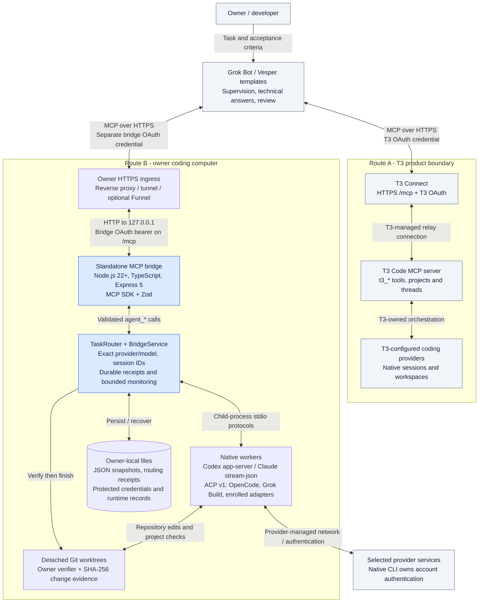
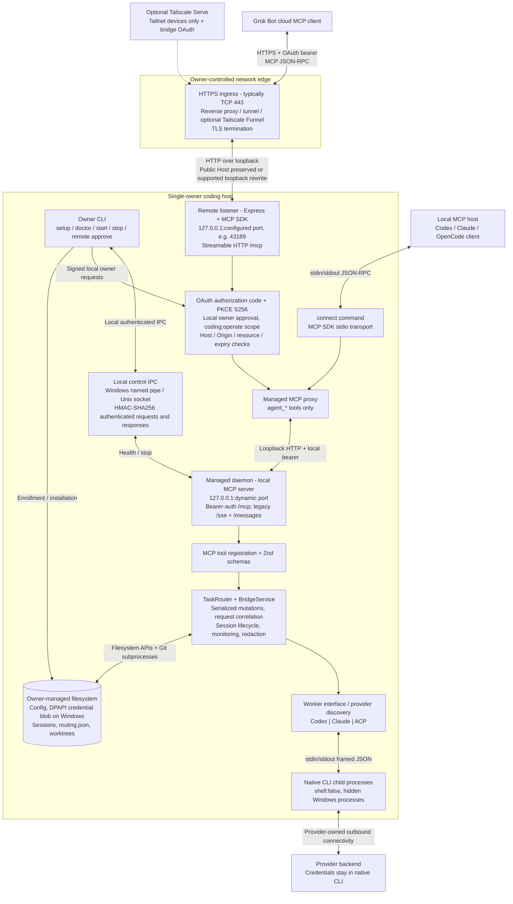
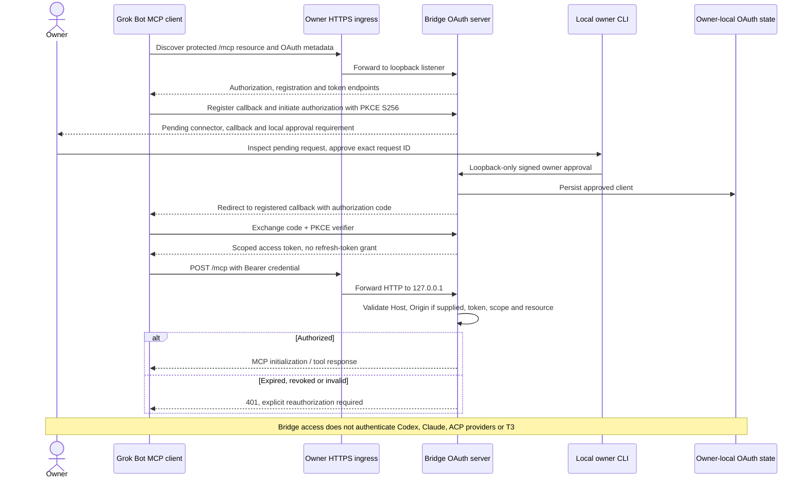
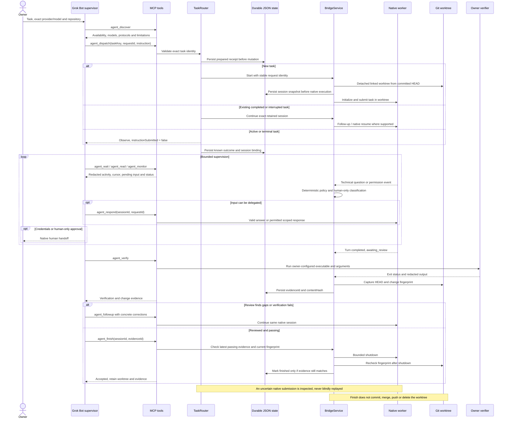
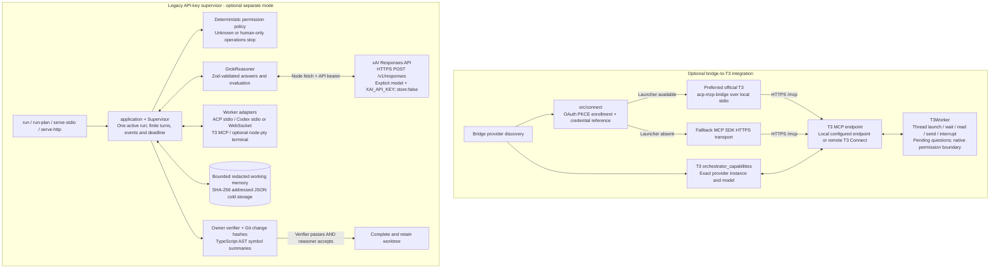

# System design: Grok Bot coding-agent bridge

Repository-grounded diagram pack for community posts and interviews. Inspected 23 October 2026 at base commit `3d121f7`, including the current working tree. Existing local changes in `src/index.ts`, `src/rpc.ts` and `src/bridge/service.ts` were left untouched.

## The 30-second explanation

Grok Bot supervises coding work through MCP. Users choose either T3's existing Connect server or this project's standalone bridge. The standalone bridge maps validated tools to exact native coding sessions, keeps task identities and recovery receipts on disk, runs workers in detached Git worktrees, and only accepts reviewed work when owner-configured verification still matches the current files. It is a single-owner local orchestration system with optional authenticated remote ingress.

## 1. Community overview

Use this diagram in a community post. Nodes identify product ownership; edge labels identify the protocol between layers. These are alternative routes selected explicitly, not automatic fallback paths.

## 2. Standalone layers and networking

The local daemon and remote listener are distinct. The remote endpoint proxies into the same managed backend. Port 43189 is a documented example, not a required default; the managed local MCP port is dynamic.

Network boundaries:

- Cloud client to owner ingress: HTTPS carrying MCP JSON-RPC. TLS terminates at the owner-controlled ingress.
- Ingress to remote listener: HTTP to `127.0.0.1:<configured port>`. The bridge itself does not terminate public TLS.
- Remote / local stdio proxy to daemon: authenticated loopback MCP HTTP, using the locally protected bridge bearer.
- Owner control to daemon: named pipe on Windows or Unix socket elsewhere, authenticated with HMAC-SHA256. This is not the public MCP endpoint.
- Bridge to native CLI: local process pipes with the selected protocol. Provider network calls and login are owned by the native CLI.
- Public OAuth discovery/enrollment endpoints are reachable before MCP authorization; owner approval endpoints require signed local requests.
- Legacy local HTTP supports `/sse` plus message POSTs; the standalone remote listener uses Streamable HTTP at `/mcp`.
- Tailscale Funnel is optional public ingress. Serve is optional private tailnet ingress. Neither authenticates the coding-provider account.

## 3. Standalone authorization sequence

This describes this repository's remote OAuth implementation, not T3's internal OAuth implementation. Requests traverse the same ingress even where sequence arrows omit that hop for readability.

## 4. Task lifecycle, persistence and acceptance

This is the `agent_dispatch` path. Direct `agent_start` is also available. Reuse a stable request ID only for the same input; retain exact bridge and native session IDs.

The loop represents repeated MCP observations, not a background cloud queue. `agent_wait` waits at most 30 seconds per call. The core bridge does not contain its own reasoning model: Grok Bot reviews evidence and requests follow-ups. A crash can leave an uncertain submission; durable intent makes that uncertainty visible, but does not make native execution exactly once.

Worktrees begin at committed HEAD; uncommitted source changes, ignored files and dependencies are not copied. Owner configuration fixes the verifier executable/arguments; project test code still needs to be trustworthy.

## 5. Optional integrations and legacy supervisor

The optional bridge-to-T3 provider is implemented, but the recommended T3 community route connects Grok Bot directly to T3. The bottom subgraph is a separate API-key execution mode.

Connect credentials are endpoint-bound. Expiry or a rejected credential requires explicit enrollment again. The official stdio bridge and direct SDK HTTPS transport are distinct implementations; do not assume every transport has identical internal redirect behavior.

Legacy `run-plan` validates task dependencies and runs them sequentially, skipping dependents after noncompletion. It retains separate worktrees and does not implicitly merge them. GrokReasoner supplies technical answers and acceptance evaluation; deterministic permission policy retains authority.

## Shareable files

Open the [offline interactive explorer](diagrams/explorer.html) for tabs, zoom, Mermaid source and SVG downloads. It embeds pre-rendered SVGs and requires no CDN or server. Mermaid sources are the editable originals; regenerate SVGs and the explorer after changing them.

| View | Mermaid source | SVG image |
| --- | --- | --- |
| Community overview | [01-system-overview.mmd](diagrams/01-system-overview.mmd) | [SVG](diagrams/01-system-overview.svg) |
| Layers & networking | [02-standalone-layers-network.mmd](diagrams/02-standalone-layers-network.mmd) | [SVG](diagrams/02-standalone-layers-network.svg) |
| OAuth enrollment | [03-oauth-enrollment.mmd](diagrams/03-oauth-enrollment.mmd) | [SVG](diagrams/03-oauth-enrollment.svg) |
| Task & acceptance | [04-task-verification-sequence.mmd](diagrams/04-task-verification-sequence.mmd) | [SVG](diagrams/04-task-verification-sequence.svg) |
| Optional & legacy | [05-optional-and-legacy.mmd](diagrams/05-optional-and-legacy.mmd) | [SVG](diagrams/05-optional-and-legacy.svg) |

## Technology inventory

| Layer | Technology actually used | Role / boundary |
| --- | --- | --- |
| Supervisor / community | Grok Bot; Vesper CLI and T3 instruction profiles | External reasoning client; templates are publisher source, not published marketplace links. |
| Runtime / language | Node.js >=22; TypeScript 5.9.3; ESM | CLI entrypoints and background daemon. CI uses Node 24. |
| MCP | @modelcontextprotocol/sdk ^1.32.1 | JSON-RPC tool contracts; stdio, Streamable HTTP and legacy SSE transports. |
| HTTP / validation | Express ^5.3.0; Zod ^3.25.76 | Routing, strict schemas, OAuth and request validation. |
| Core orchestration | TaskRouter, BridgeService, Worker interface | Durable dispatch receipts, sessions, bounded monitoring and exact provider/model selection. |
| Native protocols | ACP v1; Codex app-server; Claude bidirectional stream-json | Local child-process stdin/stdout; not one MCP server per provider. |
| Advanced transports | ws ^8.22.0; optional node-pty ^1.1.0 | Configured Codex WebSocket / legacy terminal adapter; not the default managed CLI route. |
| Network ingress | Owner reverse proxy / tunnel; optional Tailscale Funnel or Serve | TLS termination outside Node; loopback forwarding. Serve is private tailnet access, not generally cloud accessible. |
| Remote authorization | MCP SDK OAuth server; PKCE S256; Node crypto | Authorization-code flow, coding:operate scope, local signed approval and revocation; no refresh-token grant. |
| Local security | Bearer authentication; HMAC-SHA256 control IPC; Windows DPAPI CurrentUser | Separate local MCP, control and remote credentials. Owner-only directories; provider login stays native. |
| Persistence | Node filesystem APIs; JSON snapshots; atomic temporary-file replacement; fsync on relevant writes | Session state and routing receipts outside repositories. No SQL database, Redis or external queue. |
| Workspace / evidence | Git CLI; detached linked worktrees; SHA-256; owner verifier subprocess | Committed HEAD baseline, retained edits, current evidence gate; no automatic merge or push. |
| Legacy reasoning | Node fetch -> xAI Responses API; explicit API key/model | Only legacy supervisor uses this API directly; normal Bot supervision needs no xAI API key in the bridge. |
| Code summaries | TypeScript compiler AST | Symbol names and change summaries in legacy evidence; compiler API explains the pinned TypeScript version. |
| Local configuration | jsonc-parser ^3.3.1 | Preserves JSONC when registering supported MCP clients. |
| Installation / startup | npm release staging; PowerShell; Windows Task Scheduler / Startup fallback | Per-user managed release, launcher, rollback records and hidden sign-in startup. |
| Development / distribution | npm lockfile, tsc, tsx, Vitest, GitHub Actions, SHA-256 release sidecars | Build, type checks, fixture/integration tests, runtime archive and community publisher kit. |

Dependency versions above are declarations from package.json, not claims about the latest upstream versions.

## Interview discussion points

- **Why MCP?** A common discovery and tool interface for a supervisor, while adapters preserve each coding CLI's native lifecycle and permissions.
- **Why separate the two routes?** T3 already owns a server, accounts and threads. Installing another bridge is unnecessary for that path; its credentials and tool schemas remain separate.
- **Why persist intent before a native call?** A crash between submission and response creates ambiguity. Receipts prevent a retry from silently creating duplicate work; uncertain execution needs reconciliation.
- **Why files instead of a database?** This is a bounded, single-owner daemon. JSON records and atomic replacement keep installation simple. A multi-owner distributed service would need a different concurrency and storage design.
- **Why worktrees?** They separate repository edits and retain inspectable artifacts. They do not isolate OS permissions, home credentials or networking.
- **What proves completion?** The latest passing owner-verifier evidence and matching file fingerprint, checked again after worker shutdown. A worker's success message alone is insufficient.
- **What are the scaling limits?** One local owner/daemon, bounded sessions/events/turns and serialized mutations; no distributed worker scheduler or shared multi-tenant state.
- **What survives restart?** Retained session snapshots, IDs, receipts, worktrees and evidence. A process restart does not automatically resume a native turn; use explicit supported resume after inspection.
- **What remains human?** Account login, MFA, CAPTCHA, payment and native human-only approvals.
- **What stays external?** Grok Bot reasoning, T3's relay internals, native provider cloud architecture and the project's chosen public tunnel.

## Community post draft

> I built a TypeScript MCP bridge that lets Grok Bot supervise native coding agents. It supports explicit provider/model selection, retained native sessions, detached Git worktrees, crash-aware task routing and an evidence-based finish gate.
>
> There are two clear routes: connect directly through T3 Connect for T3 sessions, or use the standalone bridge for owner-enrolled CLIs. The standalone stack is Node.js, Express, the MCP SDK and Zod, with OAuth/PKCE for remote access and local JSON persistence.
>
> The interesting engineering problems were session identity, preventing duplicate instructions after uncertain failures, preserving native permissions, and rejecting stale verification evidence.

Attach diagram 1 to the post; use diagrams 2-5 for a technical follow-up or interview. This is a draft only; nothing has been published.

## Source map and evidence limits

| Concern | Repository sources |
| --- | --- |
| Public route ownership and templates | [README](../README.md), [route comparison](ROUTES.md), [community sources](../community/README.md) |
| MCP tools and shared HTTP transports | [server.ts](../src/server.ts), [tools.ts](../src/bridge/tools.ts) |
| Task identity, receipts, lifecycle, monitoring | [router.ts](../src/bridge/router.ts), [service.ts](../src/bridge/service.ts), [monitoring.ts](../src/bridge/monitoring.ts) |
| Provider protocol selection and native processes | [provider.ts](../src/bridge/provider.ts), [adapters](../src/adapters), [rpc.ts](../src/rpc.ts) |
| Standalone remote listener / OAuth | [http.ts](../src/remote/http.ts), [oauth.ts](../src/remote/oauth.ts), [owner-auth.ts](../src/remote/owner-auth.ts) |
| Local daemon, credential protection and IPC | [runtime.ts](../src/managed/runtime.ts), [credentials.ts](../src/managed/credentials.ts), [control.ts](../src/managed/control.ts) |
| Optional outward T3 connection | [t3-provider.ts](../src/bridge/t3-provider.ts), [connection.ts](../src/connect/connection.ts), [oauth.ts](../src/connect/oauth.ts) |
| Worktree and verification evidence | [worktree.ts](../src/worktree.ts), [verification.ts](../src/verification.ts), [service.ts](../src/bridge/service.ts) |
| Legacy supervisor and memory | [application.ts](../src/application.ts), [supervisor.ts](../src/supervisor.ts), [grok.ts](../src/grok.ts), [memory.ts](../src/memory.ts), [symbols.ts](../src/symbols.ts) |
| Stack and packaging | [package.json](../package.json), [contribution guide](../CONTRIBUTING.md), [distribution](DISTRIBUTION.md) |

These diagrams document inspected code and contracts. They do not certify hosted connectivity, provider compatibility for every release, account authorization, reboot behavior or production security. The bridge is not an OS sandbox. Community source profiles do not establish a published marketplace listing.

Raw Mermaid files are in [diagrams](diagrams); each can be pasted into a Mermaid-compatible Markdown editor.

